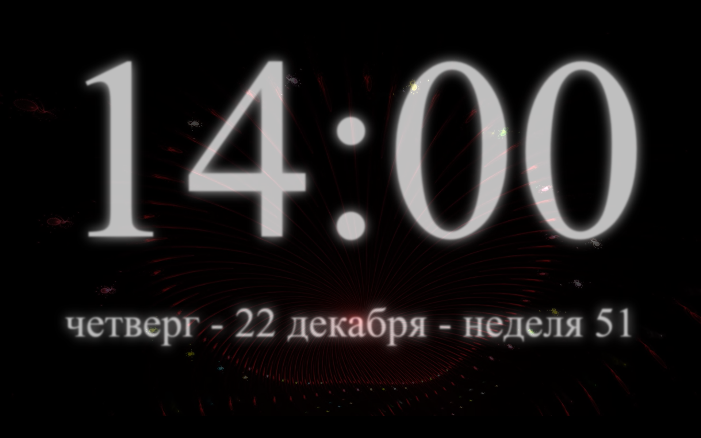

- clock with a youtube background
- press **F** to toggle fullscreen
- press **L** to switch to the next language
- press **Enter** to jump to a random video
- the background plays a shuffled list of videos (see `js/player.js`); add `?list=<playlist id>` to the URL to embed a playlist instead

